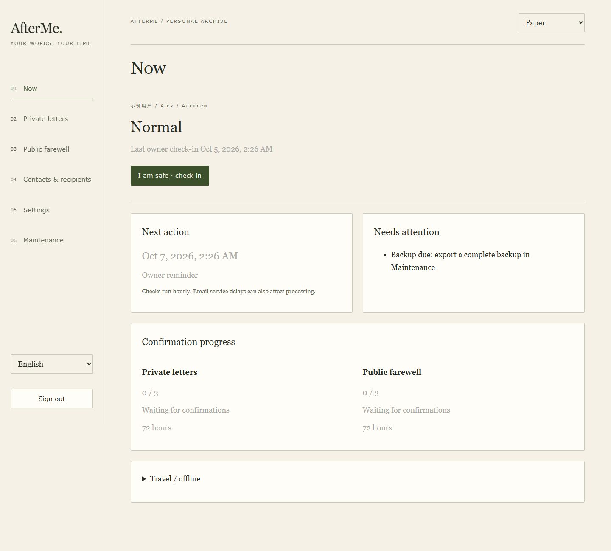

# AfterMe

[中文](README.md) · [Self-hosting](docs/DEPLOYMENT.md) · [Architecture](docs/ARCHITECTURE.md)

AfterMe is a personal check-in, absence alert and posthumous message delivery
application. Each owner deploys their own Cloudflare Worker and D1 database.
You choose reminder milestones, trusted human verifiers, quorum, buffers,
private letter recipients and public farewell channels.

Release follows the owner’s rules, explicit human confirmations and buffers.
Arrange a legal will separately.



The screenshot uses synthetic identities and example data in an isolated fixture.
[Settings](docs/images/demo-settings.png) · [Mobile](docs/images/demo-mobile.png)

## Features

- Independent private/public release rules; three presets and custom hours.
- Pending rule changes activate at the next actual owner check-in. An active
  verification round keeps its frozen rules.
- Travel pauses with expiry-based restart or manual check-in recovery.
- One people directory for verifiers and recipients, with an explicit mail-language preference.
- Private PDF letters; independent public webpage/PDF channels and audience.
- Chinese, English and Russian main UI/mail labels; night, paper and contrast
  themes, with separate PDF styles. The compatibility editor remains Chinese.
- Gmail or Resend sending, with explicit Gmail reply or web verification.
- Revocable sessions, CSRF, recent password verification, independent content
  encryption, replay checks, atomic mail quotas and manual uncertain-delivery
  reconciliation.
- Optional authenticator MFA, one-use recovery codes and email proof with atomic quotas.
- Schema 24, canonical recovery snapshots and chunk-authenticated encrypted backups;
  offline recovery accepts schemas 16–24 and older encrypted envelopes.
- Five-minute scheduled progress with bounded database/external work and resumable
  inbox, delivery and retry state.
- Optional independently scheduled background stages, lossless PDF compression and resumable
  Gmail uploads, subject to isolated CPU acceptance and a tested capacity profile.
  See [background execution](docs/BACKGROUND_EXECUTION.md).

## Start

Use Node.js 24 LTS (22.19+ is also supported) and npm:

```sh
git clone https://github.com/yasha92443/afterme.git
cd afterme
npm ci
npm test
npm run build
npx wrangler login
npx wrangler d1 create afterme
npm run setup:guided
```

The guide creates your local configuration. Set distinct ADMIN_TOKEN and
CONTENT_ENCRYPTION_KEY secrets, configure sending/verification, migrate D1,
then deploy. See [deployment steps](docs/DEPLOYMENT.md). The example starts in
dry-run with release suspended. Local builds use example configuration; tests use synthetic data and an in-memory database.

Saving text and preparing its PDF are separate operations. A browser background
worker prepares the saved version, then uploads verified chunks. Keep management
open until **PDF ready**; reopening and signing in resumes preparation after an
interruption. Text remains saved if preparation fails. Legacy mode defaults to
8 MiB per PDF; staged execution uses a separately tested capacity profile.
Choose each deployment’s capacity through isolated CPU, quota and delivery acceptance. See [PDF preparation](docs/PDF_ATTACHMENTS.md).

Keep `nodejs_compat`, the bundled font binding and all five native rate-limit
bindings in the deployment configuration. Missing bindings fail closed. The default
browser mode keeps document rendering out of save requests and scheduled delivery.

Ordinary letters are encrypted at rest. The Worker holds the content key and
decrypts letters to deliver PDFs. Passphrase letters require separate
delivery arrangements. Entire backups are sensitive, including plaintext public
drafts and contact metadata. Preserve the content key separately. A check-in
retracts webpage/link access, but previously delivered attachments cannot be
recalled. Letter text stays in its original language.

Each owner deploys the source in their own accounts and manages their data and
mail channels. Actual cost and reachability depend on providers, usage and
recipients’ network access. Manage plans and billing with those providers.

## Contribute and release

```sh
npm run rehearsal:release-flow
npm run release:check
npm run release:prepare
```

The isolated rehearsal uses synthetic data and in-memory providers. Release
preparation exports an audited, allowlisted source tree and ZIP with hashes.
Private deployment files and Git history stay in the private workspace;
the source repository is [yasha92443/afterme](https://github.com/yasha92443/afterme), with hosted results in [CI](https://github.com/yasha92443/afterme/actions). See
[contributing](CONTRIBUTING.md), [security](SECURITY.md),
[operations](docs/OPERATIONS.md), [releasing](docs/RELEASING.md) and
[readiness evidence and outstanding gates](docs/OPEN_SOURCE_READINESS.md).

Project code uses [GPL-3.0-or-later](LICENSE). Embedded font data retains its separate
[OFL license and notices](THIRD_PARTY_NOTICES.md).

Author and project copyright holder: [yasha92443](https://github.com/yasha92443), 2026.

This license allows commercial use. Distribution requires compliance with GPL corresponding-source and other conditions. See [copyright and licensing](COPYRIGHT.md).

See [security and recovery notes](docs/SECURITY_V19.md) for enrollment, paginated
content-key rotation and strict restoration. Local evidence covers source and synthetic scenarios. Verify independent
security review, account MFA, actual delivery, provider quotas and hosted CI
through their separate acceptance steps.
