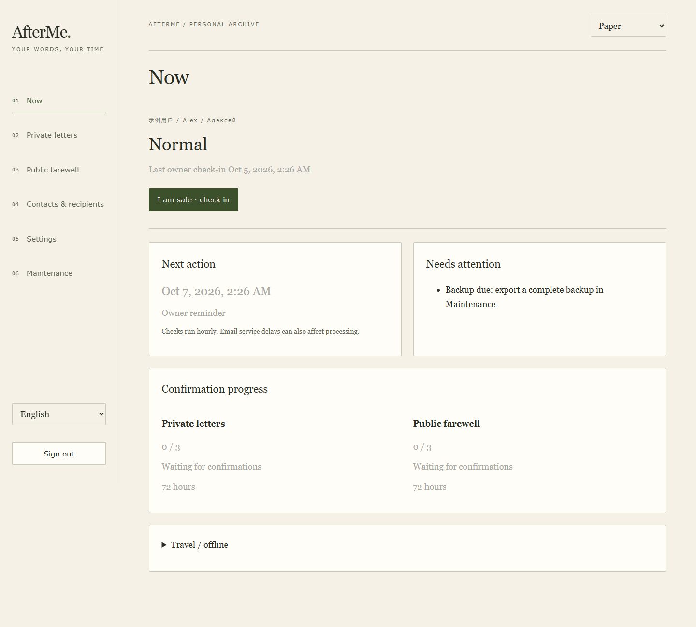

# AfterMe

[English](README.en.md) · [部署指南](docs/DEPLOYMENT.md) · [设置与规则](docs/SETTINGS_V18.md) · [贡献指南](CONTRIBUTING.md)

AfterMe 是每人独立部署的签到、失联提醒和身后信息交付工具，运行在 Cloudflare Workers + D1。你决定提醒时间、谁来确认、需要几人、等待多久，以及私人信件和公开遗言的交付渠道。

释放由预设规则、指定联系人的明确确认和缓冲共同决定。法律遗嘱请另行安排。



上图使用隔离实例中的虚构身份与示例数据。
更多 [设置演示](docs/images/demo-settings.png) 和 [手机演示](docs/images/demo-mobile.png)。

## 能做什么

- 本人签到和失联提醒；私人／公开各自设置确认名单、人数和缓冲。
- 三组时间预设与自定义；规则保存后下次本人签到生效，当前核验轮次保持原规则。
- 旅行暂停支持到期重新计时或等待本人签到恢复；签到时间保留实际记录。
- 统一人员目录只需录入一次，可分别设为确认人或信件收件人，明确选择邮件语言。
- 私人信件按收件人发送 PDF；公开遗言可独立选择网页、邮件 PDF 及邮件收件名单。
- 中文、英文、俄文主界面和邮件标签，夜读、纸页、高对比主题；PDF 样式独立。
- Gmail 或 Resend 寄信；专用 Gmail 回复或验证网页收集明确的人工确认。
- 可撤销会话、CSRF、近期口令验证、独立内容密钥、全局投递额度和防重放。
- 可选验证器 MFA、一次性恢复码和邮箱验证码；联系人取码与全局额度原子领取。
- schema 24；完整恢复数据只保留一份，浏览器分块加密，离线恢复兼容 schema 16–24。
- 默认每 5 分钟推进有预算上限的小批任务；收信、投递和重试保留进度。
- 可选分阶段独立后台调度、无损 PDF 压缩和 Gmail 分段上传；须先完成隔离 CPU
  验收再启用，容量按实测配置，见 [后台执行说明](docs/BACKGROUND_EXECUTION.md)。

完整高级编辑工具的兼容界面目前为中文。信件正文保留原文。

## 快速开始

需要 Node.js 24 LTS（也支持 22.19+）、npm，以及自己的 Cloudflare 账户。

```sh
git clone https://github.com/yasha92443/afterme.git
cd afterme
npm ci
npm test
npm run build
npx wrangler login
npx wrangler d1 create afterme
npm run setup:guided
```

引导会创建你自己的本地配置。随后交互设置 **ADMIN_TOKEN** 与独立的
**CONTENT_ENCRYPTION_KEY**，选择邮件及核验路径，迁移数据库并部署。
详见 [完整部署步骤](docs/DEPLOYMENT.md)。默认示例为 dry-run、释放暂停；
检查核验、邮件和备份之后再自行启用。本地构建使用示例配置，测试使用合成数据与内存数据库。

保存正文成功后，管理页用浏览器后台线程准备 PDF，再分块上传。**正文已保存**
与 **PDF 已准备好** 是两个状态。正文在保存成功后持续保留；关闭页面、会话过期或准备中断后，重新登录可继续准备。启用自动释放前应确认所需 PDF 全部就绪。
单份准备文件默认上限为 8 MiB；分阶段模式采用独立验收的容量配置。每个实例按隔离 CPU、配额和交付验收结果确定容量。

## 数据与交付边界

普通私人信件在数据库中加密；持有内容密钥的 Worker 在交付 PDF 时解密。
口令信件需要另外安排交付。完整备份还包含联系人、公开草稿等敏感元数据，
应整体保护并把密钥另存。

默认浏览器模式下，浏览器准备 PDF，Worker 校验、保存并在交付时读取这些文件。配置须保留 `nodejs_compat`、字体资源绑定及
五个原生限流绑定；缺少限流绑定会拒绝相应请求。详见 [PDF 流程](docs/PDF_ATTACHMENTS.md)。

签到或有效误报会取消当前轮次并撤回网页／链接；已送出的邮件和附件无法收回。
结果不明的邮件先由本人核对，再明确选择标为完成或允许重试。联系人必须能实际使用
所选核验路径；如果网页不可达，应评估专用邮箱回复路径。

每位用户使用自己的账户独立部署源码，管理自己的数据和邮件通道。
默认架构使用 Cloudflare Worker 与 D1；实际费用取决于用量与服务商套餐。
查看 [Cloudflare 配额](https://developers.cloudflare.com/workers/platform/limits/)、
[Resend 套餐](https://resend.com/pricing)，自行决定额度。套餐与账单由部署者在相应服务商管理。

## 开发与维护

```sh
npm run rehearsal:release-flow
npm run release:check
npm run release:prepare
```

隔离释放演练使用虚构数据与内存提供商。release:prepare 按白名单导出经过扫描的
源码目录、ZIP 和校验清单；生产配置、备份、日志及 Git 历史留在私有工作区。
源码仓库为 [yasha92443/afterme](https://github.com/yasha92443/afterme)，运行记录见 [CI](https://github.com/yasha92443/afterme/actions)。

- [架构与信任边界](docs/ARCHITECTURE.md)
- [运维与备份恢复](docs/OPERATIONS.md)
- [PDF 和字体](docs/PDF_ATTACHMENTS.md)
- [发布流程](docs/RELEASING.md)
- [安全问题报告](SECURITY.md)
- [开源就绪状态与待完成验证](docs/OPEN_SOURCE_READINESS.md)
- [更新记录](CHANGELOG.md)

代码采用 [GPL-3.0-or-later](LICENSE)，嵌入字体保留 [OFL 及第三方声明](THIRD_PARTY_NOTICES.md)。

作者与项目版权持有人：[yasha92443](https://github.com/yasha92443)，2026 年。

该许可证允许商用；分发修改版本须遵守 GPL 的源码提供等要求。详见 [版权与许可说明](COPYRIGHT.md)。

安全加固、验证器绑定、分页密钥迁移、加密备份与恢复见 [安全说明](docs/SECURITY_V19.md)。本地记录覆盖源码与合成场景检查；独立安全审阅、账户 MFA、实际邮件送达、云端配额和托管 CI 分别验收。
