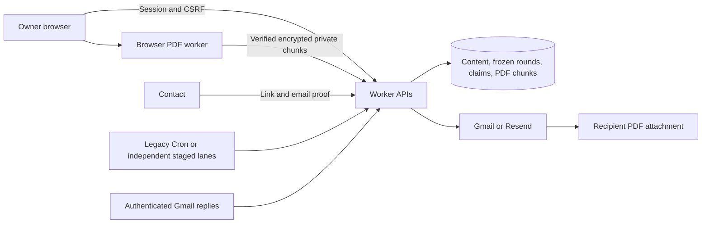

# Architecture

AfterMe uses one Cloudflare Worker and D1 database per owner, with that owner’s
accounts, credentials and data. The example uses schema 24, `nodejs_compat`, bundled static assets,
all five native rate-limit bindings and a five-minute legacy scheduled trigger.
Optional staged execution requires a minute trigger and the isolated CPU gate
described in [background execution](BACKGROUND_EXECUTION.md).

## State and bounded work

Settings are validated and versioned. Saved rule changes activate only at an
actual owner check-in; an active round retains its frozen rules. False alarms and
travel pauses cancel a round while preserving the actual owner check-in time. Private/public
progress remains independent. Draft/document revisions protect apply and discard
as well as individual edits.

The five-minute scheduled invocation handles bounded inbox/transition/delivery
work. A shared budget counts D1 calls, SQL statements and external requests before
dispatch. Inbox cursors, claims and retry state preserve progress across later
runs. Budget exhaustion defers work rather than treating an unsent operation as
an uncertain provider submission. Current inbox failures/backlog block release;
historical failures are retained for diagnosis and explicit reconciliation.

These application safeguards are covered by local counters, tests and dry builds.
Measure Cloudflare CPU use and provider limits in the isolated deployment.

## Browser preparation and delivery

Saving a letter commits its encrypted text first. Applying public drafts commits
the guarded formal version. The browser then reads that saved source, renders its
PDF in a background Worker with bundled fonts and uploads 128 KiB chunks. The
server validates source/layout revisions, chunk hashes and PDF markers before
marking an artifact ready. Staged execution authenticates an ordered chunk
manifest; the client's whole-file SHA remains a separate declaration. Private
chunk payloads are encrypted. The default artifact capacity is 8 MiB; staged
deployments configure a separately tested `PDF_MAX_BYTES` capacity within the
resource guard and provider MIME limit. Saved text is retained through generation/upload failures; a later authenticated browser session resumes preparation.

The default `PDF_GENERATION_MODE=browser` avoids large document rendering inside
save requests and Cron. Delivery reads a current validated artifact; unavailable
or corrupt PDF data defers delivery and remains visible for maintenance. Legacy
server-generation compatibility is retained for explicitly configured deployments
with a separate Free CPU acceptance step for large documents.

The browser font assets and Worker use the same PDF layout. Document text is processed with the bundled font assets. The optional local SimSun/Times New Roman tool generates separate
local files. See [PDF preparation](PDF_ATTACHMENTS.md) and
[font notices](../THIRD_PARTY_NOTICES.md).

## Authentication and data

Administrative setup requires authentication. Revocable sessions, origin/CSRF
checks, optional TOTP MFA, bounded bodies and native rate limits protect requests.
Missing native bindings fail closed; a development-only fallback requires an
explicit environment setting. Verification combines current round/token checks
with email proof or authenticated explicit Gmail replies.

The content key encrypts ordinary letters, private PDFs and MFA material. The
Worker can decrypt ordinary content to deliver it; the deployment/browser/mail
accounts remain trusted. Passphrase letters need separate delivery arrangements.
Sent attachments cannot be recalled. Secret rotation must migrate all encrypted
surfaces, including MFA and uploaded private PDF chunks.

## UI, monitoring and recovery

Management directories, chapter bodies, public reading and recycle views use
bounded pages; selected private bodies load on demand. Public health reads a
coarse persisted snapshot with freshness checks rather than repeatedly running the
full private diagnostic scan. Management retains detailed authenticated diagnostics.
Public reading/formal previews cap their entire HTML at 64 KiB and directory
pages at 20 chapters. UTF-8 continuation cursors cover long titles, epigraphs and
entry bodies. Formal revision fences prevent mixed versions; public release gates
run before text reads and are rechecked after them.

Schema 24 complete exports use one copy of the canonical recovery tables. Browser/CLI encryption format 2 authenticates independent 1 MiB chunks.
Offline tooling supports schemas 16–24 and encrypted formats 1/2, verifies shape,
rules, relations and ciphertext, then exercises restored application reads. Recovery
starts suspended with a new round and invalid links; the restored owner signs in to a new session.
Schema 21 and later snapshots must include a nonnegative document `pending_count` that
matches their formal/draft rows; missing or inconsistent cached counts fail closed.
Schema 23 retains both original person identities in a one-to-one `people_links`
bridge. Frozen verifier/audience IDs are retained. Original profile
differences survive migration; explicit edits synchronize the selected fields.
Recovery validates complete links and rebuilds them after loading older snapshots.
See [operations](OPERATIONS.md) and [security boundaries](../SECURITY.md).
